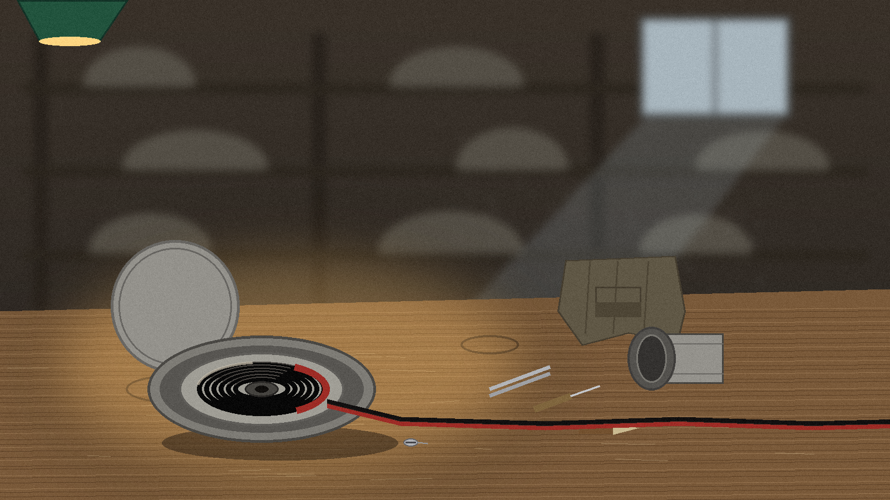
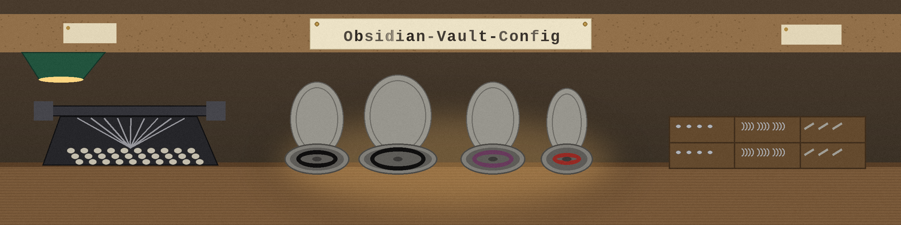

# Obsidian-Vault-Config

> **SOURCE** The mappings live in the dotfiles home. This vault holds the link, so there is no second copy here to drift out of step.

An open source project by Epsilon0xCell.

## What is in this repo

- `.obsidian.vimrc`, a symlink, not a copy
- LICENSE
- This README, plus the branding images

## Why this repo looks almost empty

I keep only one real thing here: `.obsidian.vimrc`, and it is a symlink, not a copy. It points at the vimrc file in my dotfiles. I set it up that way so my mappings live in one place and I only edit them there, instead of keeping a second copy in this repo that would drift out of date.

The link points at a path on my own Mac. On any other machine it will not resolve until I point it at a local copy of that file.

The previous title of this page, "Obsidian Main", did not match the
repo name after the rename to Obsidian-Vault-Config. The title above
now matches the repo name; the symlink explanation is unchanged.
